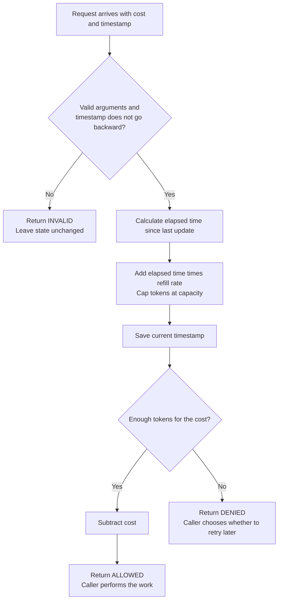
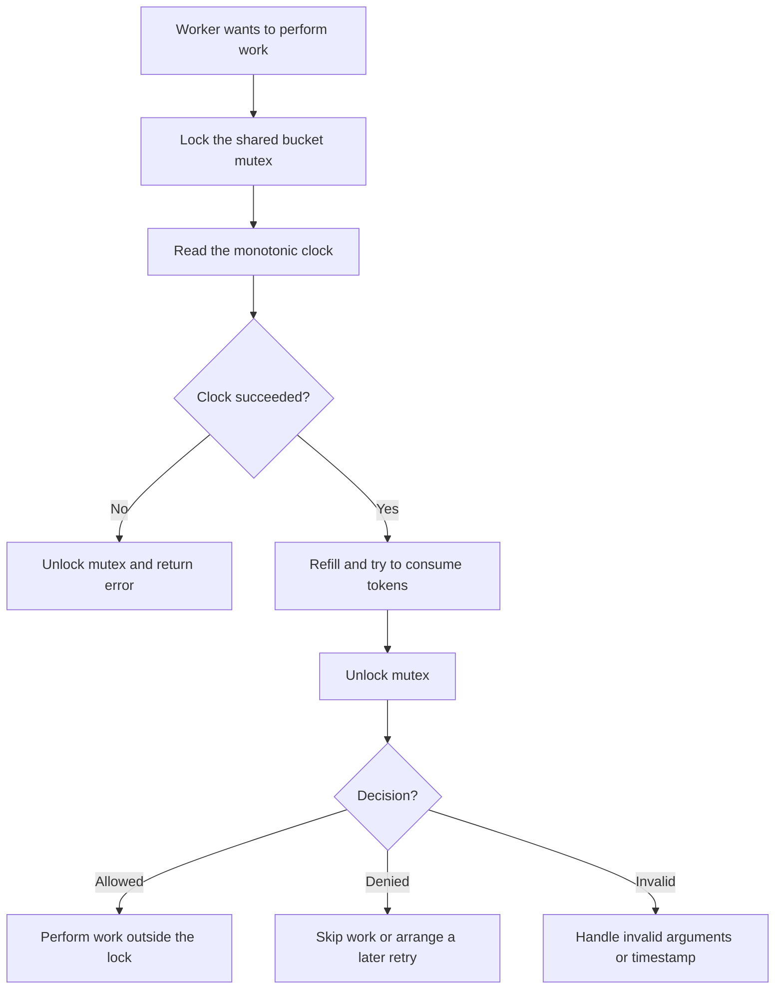

# Token bucket rate limiter

A small C exercise that limits how quickly work is accepted while allowing short
bursts. It demonstrates structs, pointers to caller-owned state, elapsed-time
arithmetic, floating-point bounds, and deterministic tests. A POSIX threads wrapper
adds safe sharing between workers using a mutex.

## How it works

Imagine a bucket that holds tokens. Each request spends some tokens, and time adds
new tokens at a fixed rate. A full bucket cannot store any more tokens.

- **Capacity** controls the maximum saved burst.
- **Refill rate** controls the sustained budget in tokens per second.
- **Cost** is the number of tokens a request needs; it can vary by request.

The bucket starts full. On each valid request:

```text
elapsed = now - last_update
tokens = min(capacity, tokens + elapsed * refill_rate)
last_update = now

if tokens >= cost:
    tokens = tokens - cost
    allow the request
else:
    deny the request without spending tokens
```

Refill is calculated only when a request arrives. There is no background thread
or periodic timer, and each operation takes O(1) time and O(1) space.



With capacity **3**, refill rate **2 tokens/second**, and cost **1**, three requests
can pass immediately. A fourth request at the same timestamp is denied. After
half a second, one token is available again. A long idle period restores at most
three tokens, regardless of how much time passed.

The rate is an average budget with a burst allowance, rather than a strict count
for each one-second window. Starting full, the available budget over `t` seconds
is at most `capacity + refill_rate * t` tokens, subject to floating-point rounding.

## Files

| File | Purpose |
| --- | --- |
| `token_bucket.h` | State, result enum, and API contracts |
| `token_bucket.c` | Validation, refill, and consumption |
| `main.c` | Scripted demo and optional live-clock demo |
| `test_token_bucket.c` | Assertions using explicit timestamps |
| `threaded_token_bucket.h` / `.c` | Mutex-protected bucket and clock handling |
| `threaded_demo.c` | Four workers sharing one real-time budget |
| `test_threaded_token_bucket.c` | Concurrent budget checks using a controlled clock |

## Build and run

Run these commands from the repository root. The core and tests use C11. The
demo uses POSIX `clock_gettime(CLOCK_MONOTONIC)` and `nanosleep` for live mode,
so these demo commands target macOS and Linux. There are no third-party libraries.

```sh
mkdir -p build
cc -std=c11 -Wall -Wextra -Wpedantic \
  intermediate/token_bucket/token_bucket.c \
  intermediate/token_bucket/main.c -o build/token_bucket
./build/token_bucket
```

The default demo supplies simulated timestamps and finishes immediately:

```text
Token bucket: capacity = 3, refill = 2 tokens/second (simulated time)
Seconds  Cost  Result   Tokens left
   0.00   1.0  allowed  2.00
   0.00   1.0  allowed  1.00
   0.00   1.0  allowed  0.00
   0.00   1.0  denied   0.00
   0.25   1.0  denied   0.50
   0.50   1.0  allowed  0.00
   1.00   2.0  denied   1.00
   1.50   2.0  allowed  0.00
   3.00   1.0  allowed  2.00
```

To use an actual monotonic clock and pauses between requests:

```sh
./build/token_bucket --live
```

Live mode takes about three seconds; scheduling delays can change the displayed
timestamps, token balances, and decisions. Both modes exit after the sequence.
Unknown arguments produce a usage message and a nonzero exit status. The demo
reads no interactive input and creates no data files.

Build the tests separately because both the demo and tests define `main`:

```sh
cc -std=c11 -Wall -Wextra -Wpedantic \
  intermediate/token_bucket/token_bucket.c \
  intermediate/token_bucket/test_token_bucket.c -o build/test_token_bucket
./build/test_token_bucket
```

Keep assertions enabled (do not use `-DNDEBUG`). The six test groups cover burst
exhaustion, fractional refill and costs, capacity capping, invalid initialization,
invalid requests including backward time, and very large refills. They require
no sleeps and print `All token bucket tests passed (6 groups).` on success.

## Using the API

```c
#include "token_bucket.h"

TokenBucket bucket;
if (!token_bucket_init(&bucket, 10.0, 2.0, 0.0)) {
    /* Handle invalid configuration. */
}

/* This example uses simulated seconds from the same origin as initialization. */
TokenBucketResult result = token_bucket_try_consume(&bucket, 1.0, 0.5);
if (result == TOKEN_BUCKET_ALLOWED) {
    /* Perform the work. */
} else if (result == TOKEN_BUCKET_DENIED) {
    /* Reject the work, or arrange to retry later. */
} else {
    /* Handle an invalid cost or timestamp. */
}
```

Initialize successfully before consuming; all numeric arguments must be finite.
Capacity and refill rate must be positive. Cost must be positive and no greater
than capacity. Initial time must be nonnegative, and later timestamps must not
go backward. Equal timestamps are allowed. An oversized request is invalid
because even a full bucket could never pay for it.

`TOKEN_BUCKET_DENIED` still saves the refill and timestamp. `TOKEN_BUCKET_INVALID`
leaves the bucket unchanged; initialization failure also leaves it unchanged.
The struct belongs to the caller, needs no allocation or cleanup, and its fields
should only be modified by the API. Reading `tokens` shows the balance at the
last valid request, rather than a continuously updated balance.

Production callers should supply seconds from one monotonic clock, which avoids
wall-clock corrections. Using seconds relative to a recent origin helps preserve
fractional precision. Floating-point arithmetic is approximate; this exercise is
not intended for exact accounting at extreme magnitudes or time resolutions.

## Sharing a bucket between threads

The original `TokenBucket` has no internal lock. For a shared budget, use
`ThreadedTokenBucket` from `threaded_token_bucket.h`. Its mutex protects the
entire clock-read, refill, check, and subtraction sequence. Two workers cannot
spend the same saved token.

The clock is read **after acquiring the mutex**. If threads took timestamps before
locking, a delayed thread could submit an older timestamp after another worker
had already updated the bucket.



Only admission to the work is serialized. Approved work can run in parallel.
For example, if eight threads each request one token from a bucket containing
one token at a fixed timestamp, exactly one succeeds. The others are denied.

### Build the threaded demo and tests

Run from the repository root on macOS or Linux. Add `-pthread` when compiling and
linking the threaded programs; the original core/demo commands still work.

```sh
mkdir -p build
cc -std=c11 -Wall -Wextra -Wpedantic -pthread \
  intermediate/token_bucket/token_bucket.c \
  intermediate/token_bucket/threaded_token_bucket.c \
  intermediate/token_bucket/threaded_demo.c -o build/threaded_token_bucket
./build/threaded_token_bucket

cc -std=c11 -Wall -Wextra -Wpedantic -pthread \
  intermediate/token_bucket/token_bucket.c \
  intermediate/token_bucket/threaded_token_bucket.c \
  intermediate/token_bucket/test_threaded_token_bucket.c -o build/test_threaded_token_bucket
./build/test_threaded_token_bucket
```

The demo starts four workers sharing capacity **3** and refill rate **2 tokens per
second**. Each worker makes six requests costing one token, with 250 ms between
attempts. It finishes after about 1.25 seconds and prints per-worker and total
allowed/denied counts. Counts and which workers succeed depend on scheduling;
this implementation makes no fairness guarantee. The main thread reads each
worker's counters only after joining that worker. The demo creates no data files.

The tests keep assertions enabled and use eight workers making 128 attempts per
contention round. A mutex/condition-variable gate releases the workers together.
An injected clock keeps time fixed during a round, so exact expected totals are
independent of wall-clock delays. Time advances only after the workers are joined.
The four test groups cover shared bursts and weighted costs, fractional refill
and capacity capping, invalid input and clock failures, and the default clock.

### API and lifetime

| Function | Purpose |
| --- | --- |
| `threaded_token_bucket_init` | Initialize a full bucket using `CLOCK_MONOTONIC` |
| `threaded_token_bucket_init_with_clock` | Initialize with a callback and context, useful for deterministic tests |
| `threaded_token_bucket_try_consume` | Lock, read time, refill, decide, and unlock |
| `threaded_token_bucket_destroy` | Release the mutex after all workers have stopped |

Initialize once before publishing the bucket to workers, then join **all** workers
before destroying it. The caller owns the struct; no heap allocation is needed.
Do not copy or move an initialized struct, directly access its fields, mix core
calls with wrapper calls on it, or destroy it while another thread may use it.
Failed initialization needs no destruction. A destroyed bucket can be initialized
again before reuse.

These functions return **0 on success** or a positive error code. Use
`strerror(error)` for that code; pthread functions return errors directly rather
than setting `errno`. For consumption, success also writes a `TokenBucketResult`:

```c
TokenBucketResult result;
int error = threaded_token_bucket_try_consume(&bucket, 1.0, &result);
if (error != 0) {
    /* Handle the clock or synchronization failure; result was not written. */
} else if (result == TOKEN_BUCKET_ALLOWED) {
    /* Perform work here: the mutex is already unlocked. */
} else if (result == TOKEN_BUCKET_DENIED) {
    /* Skip work or arrange a later retry. */
} else {
    /* Handle an invalid cost or timestamp. */
}
```

Clock failures release the lock and leave the token state unchanged. Invalid
costs and timestamps return `TOKEN_BUCKET_INVALID` without changing token state.
An unexpected unlock failure is a synchronization error: state may already have
changed, so do not blindly retry the operation. The demo stops on errors and joins
successfully created workers before destroying the bucket.

A custom clock callback returns 0 and writes finite, nonnegative seconds, or
returns an error code. It runs during initialization and under the bucket lock
during consumption; it must not call back into that bucket. Keep its context
alive until destruction and synchronize any external changes to that context.
The default clock needs no caller-managed context.

The shared bucket limits how quickly work starts. It does **not** limit the number
of operations currently running. Use a separate concurrency limit if needed.

## Where it can be used

| Use case | What tokens represent | Example policy |
| --- | --- | --- |
| API request limiting | Requests per client or API key | Allow a burst of 10, then refill 2 per second |
| Outbound service calls | Calls to a dependency | Spend a token before sending each call |
| Network traffic shaping | Bytes | Charge each packet's size; defer it when tokens are insufficient |
| Background jobs | Jobs or estimated work units | Let a worker process a burst, then settle to a steady budget |
| Repeated log messages | Messages | Suppress excessive repeats while allowing an initial burst |

Choose the cost unit first, then set the refill rate and capacity in that unit.
For byte-based limits, capacity must be at least the largest accepted packet.
A separate bucket per client isolates budgets; one shared bucket imposes a global
budget. Those choices belong to the calling application.

This implementation makes an immediate admission decision. It does not queue,
sleep, send HTTP responses, or perform work itself. A traffic shaper needs a queue
and scheduling around it. For a denied valid request, the ideal wait for enough
tokens is `(cost - bucket.tokens) / bucket.refill_rate` seconds, assuming no other
consumer spends tokens first.

Multiple threads in one process can use the wrapper above to share a budget.
Multiple processes or servers need shared state and an atomic decision to enforce
one combined limit. This exercise does not provide distributed coordination.
